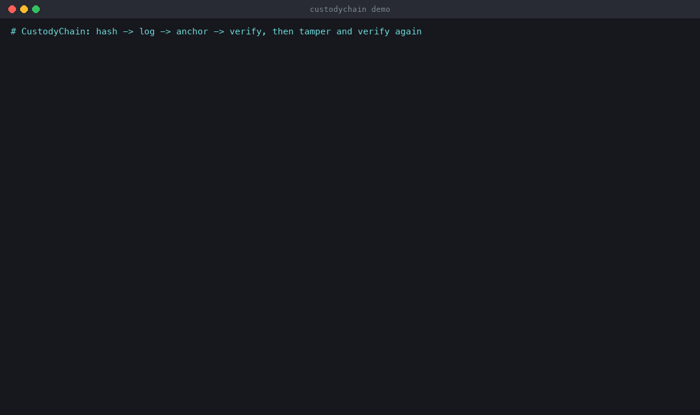

# CustodyChain

**Chain of custody as cryptographic proof, not a spreadsheet and a signature.**
Every evidence file is hashed in 4 MiB chunks into an RFC 9162 Merkle tree. Every analyst
action is a signed, hash-chained entry in an append-only log. The log root is anchored with
RFC 3161 timestamps from independent authorities. A separate verifier, which shares no code
with the writer and needs only the Python standard library, proves months later that nothing
changed between seizure and court. When something did change, it says exactly what.



```text
$ custody-verify demo-case/tampered/case.db --tsa-ca trust/ --expect-genesis d51c1847… --evidence EX-002=EX-002.raw
[FAIL] Hash chain, ordering and completeness — 15 entries
        seq 7: prev hash does not match entry #6 - the chain breaks here (an earlier entry was edited, deleted or reordered)
[FAIL] Analyst signatures, key roster and witness co-signatures — 14/15 entries carry a valid signature
        seq 6: Ed25519 signature by alice (ed25519:13ca2e9711fe5139a065445d06c2d58b) does not verify - entry altered
[FAIL] Exhibit EX-002 - USB stick found in desk drawer — root 0c0d9e553dcb08ea… over 6 chunks
        chunk 3 differs: bytes 12582912..16777215
[FAIL] RFC 3161 anchors of the log root — 3/9 tokens valid
        anchor 4 (freetsa): entries 0..11 no longer hash to the timestamped root (modified after anchoring)
RESULT: FAIL
```

Sample reports built from a synthetic case:
**[clean verification (PDF)](docs/sample-verification-report.pdf)** ·
**[tampered case (PDF)](docs/sample-tampered-report.pdf)**

## How it works

```
evidence file ─► chunker (4 MiB) ─► SHA-256 leaves ─► Merkle root (per exhibit)
analyst action ─► entry {prev, actor, key_id, action, exhibit_root, time} ─► Ed25519 signature (+ witness co-signature)
every N entries ─► log Merkle root ─► RFC 3161 TSAs (FreeTSA + DigiCert) ─► signed timestamp tokens
custody-verify ─► recompute leaves ─► check chain + signatures + roster ─► check TSA tokens ─► PDF / JSON report
```

| Piece | What it does |
|---|---|
| **Hasher** | Streams fixed 4 MiB chunks in parallel worker processes, with RFC 9162 domain-separated leaf/node hashes (`0x00`/`0x01`). Resumable after a crash; refuses evidence that changes mid-hash; warns on writable evidence. E01 images are hashed as decoded **media**, and their embedded MD5/SHA-1 are verified and recorded alongside. |
| **Ledger** | SQLite (WAL, `synchronous=FULL`). Canonical-JSON entries carry the previous entry's hash. No UPDATE/DELETE code paths, plus guard triggers, though the security comes from the cryptography. |
| **Signer** | Per-analyst Ed25519 keys in scrypt-encrypted files. The key roster lives *in* the log: genesis lists the initial keys, admins sign `key_add` / `key_revoke`, and revocation can declare `compromised_since_seq`. Handovers are co-signed by the receiving analyst. |
| **Anchor** | RFC 3161 timestamps of the log root from two TSAs by default. Raw tokens are stored, and the anchor itself is logged. A local TSA (`custody tsa`) covers tests and air-gapped labs. |
| **Verifier** | `custodyverify`: its own DER parser, Ed25519, RSA PKCS#1 v1.5/PSS, ECDSA P-256/384/521, X.509 chain building, CMS/RFC 3161 checks and Merkle maths, standard library only. It runs on a copy of the database and never writes to it. |
| **Reporter** | Court-ready PDF: exhibits and hashes, custody timeline with TSA-proven time windows, timestamp chains, key roster, pass/fail per check, and the command to re-run it. An optional annex drafts the data for a **Section 63 BSA 2023** certificate. |

## The spec's test cases, all automated

| Test | Result | Where |
|---|---|---|
| Flip one byte in a 50 GB image → verifier names the exact failing chunk | ✅ chunk 1,081 named after a 54 s re-hash | `tests/test_large.py` (`-m slow`) |
| Hash a 10 GB image; inclusion proof for any chunk | ✅ 7.4 s, proof ≤ 12 hashes, verified by the independent verifier | `tests/test_large.py` |
| Delete, reorder or edit a ledger row in SQLite → chain fails at that row | ✅ names the row and the break | `tests/test_tamper.py` |
| Entry signed by an unknown key → fails with the key fingerprint | ✅ `signed by unknown key ed25519:…` | `tests/test_tamper.py` |
| Truncate the log and re-anchor → consistency against the earlier anchored root fails | ✅ via surviving anchors and via exported checkpoints | `tests/test_tamper.py` |
| Corrupt the TSA token / wrong CA bundle → fails cleanly, not silently | ✅ specific reason, never a crash | `tests/test_tamper.py` |
| Any single-byte change must break verification (property test) | ✅ Hypothesis: evidence bytes and entry bits | `tests/test_properties.py` |
| Benchmark SHA-256 vs BLAKE3, single vs multi-process | ✅ [docs/benchmarks.md](docs/benchmarks.md) | `custody bench` |

Plus: compromised-key windows, revoked keys, non-admin key management, forged witness
co-signatures, future-dated and backdated entries, leaf-cache tampering, genesis pinning,
E01 container damage, crash/resume, and a guarantee that the verifier never modifies the
case file. Hostile-input tests cover looping and decompression-bomb E01 containers, forged
revocations, absurd chunk sizes and a case read while the writer still has it open.
**55 tests** in ~11 s, plus the slow multi-GB test.

Verified against the real world, not just against itself:
* Merkle code in both packages matches Certificate Transparency's published test vectors.
* Ed25519 matches RFC 8032 test vector 1. Ed25519, RSA and ECDSA are cross-checked against
  `cryptography`. The P-521 order constant is checked by asserting n·G = O (that check
  caught a typo in it).
* The verifier validates live tokens from **FreeTSA (ECDSA P-384), DigiCert, Sectigo and
  GlobalSign (RSA)** against their real roots, and tokens from the local test TSA pass
  `openssl ts -verify`.
* E01 images written by the fixture writer are read identically by libewf (`pyewf`).

## Quick start

```bash
python3.12 -m venv .venv && . .venv/bin/activate
pip install -e ".[dev]"

custody keys new admin --role admin -o keys/admin.key
custody keys new alice -o keys/alice.key
custody keys new bob -o keys/bob.key
custody init case.db --case CASE-0001 --title "Test case" --admin-key keys/admin.key \
    --member keys/alice.pub --member keys/bob.pub          # prints the genesis hash: keep it

custody acquire case.db disk.E01 --exhibit EX-001 --label "Laptop SSD" --key keys/alice.key
custody handover case.db EX-001 --from-key keys/alice.key --to-key keys/bob.key --reason "peer review"
custody anchor case.db --key keys/bob.key                 # FreeTSA + DigiCert
custody checkpoint case.db -o checkpoint.json              # give this to the other side

custody verify case.db --tsa-ca trust/ --expect-genesis <hash> \
    --evidence EX-001=disk.E01 --pdf report.pdf            # or: custody-verify (stdlib only)
```

Or build the whole synthetic case, verify it, tamper with it and verify again:

```bash
python scripts/demo.py --out demo-case --tsa real \
    --report docs/sample-verification-report.pdf --tamper-report docs/sample-tampered-report.pdf
```

| Command | |
|---|---|
| `custody keys new / add / revoke / list` | analyst keys and the in-log roster |
| `custody init` | open a case; the genesis entry carries the roster |
| `custody acquire` | hash raw or E01 evidence into a Merkle tree and log it (`--workers`, `--alg blake3`, `--require-readonly`, `--digests`) |
| `custody copy` / `export` | log a verified bit-for-bit copy / a derived artefact |
| `custody log-action` | mount, analyze, verify, note, seal |
| `custody handover` | transfer with the receiver's co-signature |
| `custody anchor` | RFC 3161 timestamp of the log root (`--tsa freetsa --tsa digicert --tsa name=url`) |
| `custody checkpoint` · `prove chunk / entry / consistency` | CT-style proofs |
| `custody verify` · `custody-verify` · `custody-verify consistency` | independent verification |
| `custody bsa63` | draft data sheet for a Section 63 BSA certificate |
| `custody tsa init / serve` | local RFC 3161 TSA |
| `custody bench` | hashing throughput |

## Design and threat model

**[docs/design.md](docs/design.md)** covers insider edits, deletion, truncation and re-anchoring,
whole-case rebuilds, clock tampering, evidence substitution, key theft and loss, rogue
analysts, unwitnessed handovers, TSA compromise and verifier bugs: each one's defence, and
what remains possible.

Three of those design answers in short:
* **Clock tampering.** The analyst's clock is recorded but never trusted. Each entry gets a
  *provable window*: it existed before the first TSA token covering it and was written
  after any token logged before it. The verifier flags claimed times outside that window.
* **Key theft.** Revocation is not retroactive by default, so past work stays valid. When a
  theft is discovered, the admin declares `compromised_since_seq`, and every entry signed by
  that key from that point fails verification.
* **Verifier independence.** `custodyverify` imports nothing from the writer and nothing
  outside the standard library. Its cryptography is written from the RFCs and FIPS 186-4 and
  cross-checked against `cryptography` in the tests, so a writer bug cannot hide inside a
  shared helper.

## Limits

* Revocation of TSA certificates (CRL/OCSP) is not checked; the verifier is offline by design.
* If an insider deletes the log tail **and** every anchor row covering it, the shortened log is
  internally consistent. Catching that needs a checkpoint held by someone else, or the pinned
  genesis plus TSA dates. Hand out checkpoints at milestones.
* Keys are password-protected files (the MVP), not hardware tokens.
* The E01 writer is for fixtures and demos (single segment, < 2 GiB). The reader handles
  multi-segment EnCase-style images and is cross-checked against libewf.
* The BSA s.63 annex is a draft data sheet, not legal advice: confirm the prescribed format
  with your lab's legal team.

## Security

The verifier treats the case file, evidence, E01 containers and tokens as hostile input. Hardening,
the signature-verification guarantees and the known limits (offline revocation, minimal path
validation, genesis pinning) are listed in [SECURITY.md](SECURITY.md).

## Licence

MIT. Trust anchors in `trust/` are public CA certificates (see `trust/README.md`).
